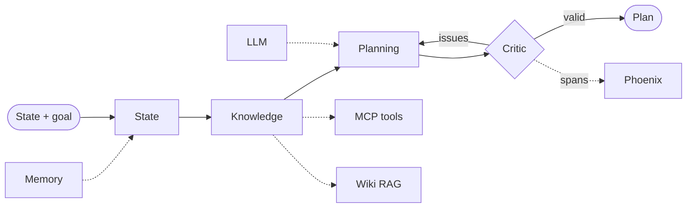
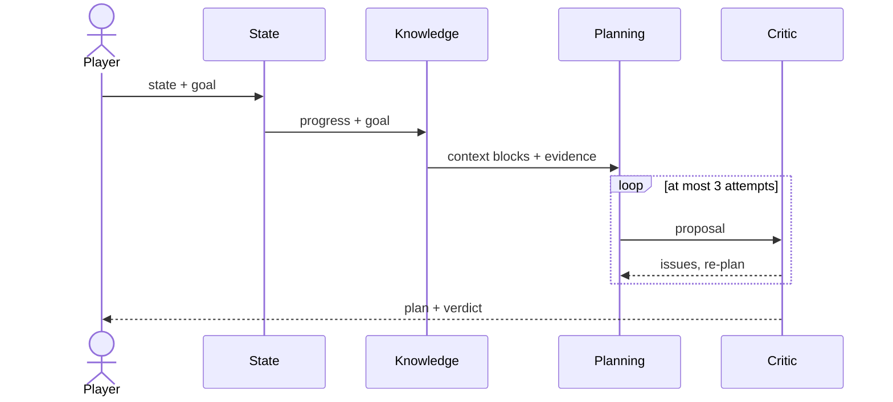
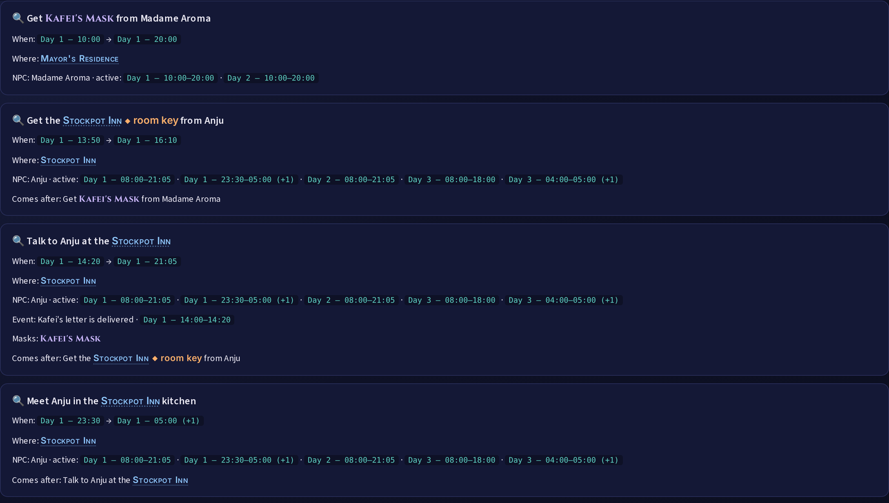
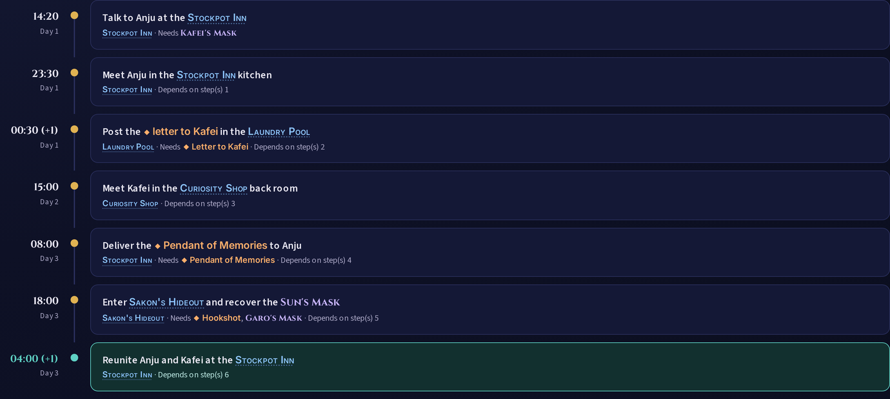
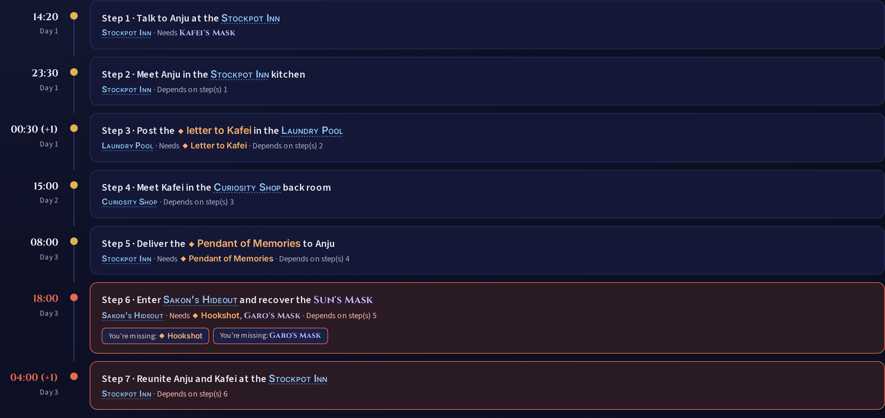
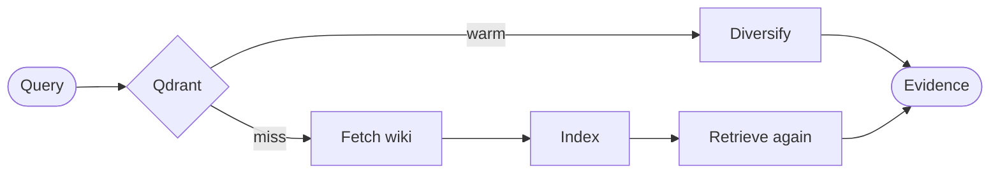
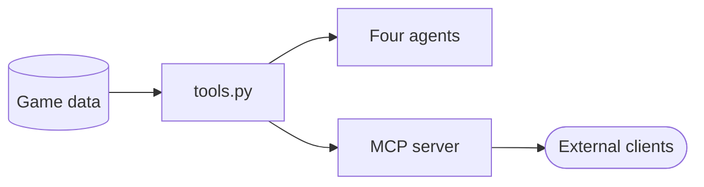
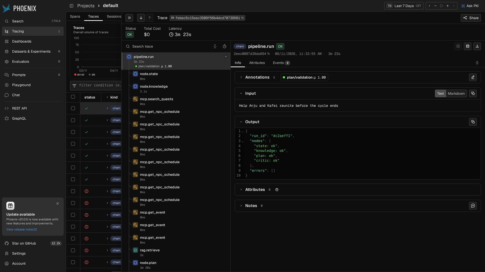
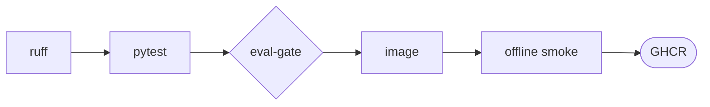

<!-- _class: cover -->
<!-- _paginate: false -->


A temporal planner for *The Legend of Zelda: Majora's Mask*

**Michele Ferro** · *AI Engineer/DevOps Engineer*

---

<!-- _class: gold t1 -->

# 01

## THE PROBLEM

<hr>

"*Link, the Moon is going to fall in three days!*"

---

<!-- _class: light t1 -->

<!-- _header: '01 · PROBLEM' -->

## Time is the antagonist

<hr>

- Three days, one deadline: the moon falls at the end of Day 3
- NPCs keep schedules; doors, events and letters close for good
- Progress is a chain: a mask opens a door, an item is traded away
- A chatbot answers *what to do* — the player needs *what to do now*
- Retrieval is not the hard part: **temporal feasibility is**

---

<!-- _class: gold t2 -->

# 02

## THE IDEA

<hr>

"*A fairy that does not just follow you, but tells you what today can still hold.*"

---

<!-- _class: light t2 -->

<!-- _header: '02 · IDEA' -->

## Plan, don't chat

<hr>

- **Input**: the full game state plus one goal
- **Output**: ordered, time-slotted steps — or an explicit verdict why not
- The LLM proposes; a deterministic core grounds, clamps and validates
- Every step carries its window, location and prerequisites
- No answer without a check: the Critic rebuilds the whole chain

---

<!-- _class: gold t3 -->

# 03

## ARCHITECTURE

<hr>

"*Four giants hold up the Moon: four agents hold up the plan.*"

---

<!-- _class: light t3 -->

<!-- _header: '03 · ARCHITECTURE' -->

## One run, and the system around it

<hr>



Solid: the plan path. Dashed: memory, sources, model and tracing.

---

<!-- _class: light seq t3 -->

<!-- _header: '03 · ARCHITECTURE · EXECUTION' -->



A terminal issue stops the loop at once, without using the attempts left.

---

<!-- _class: gold t4 -->

# 04

## THE FOUR AGENTS

<hr>

"*One reads the state, one the world, one plans, one doubts.*"

---

<!-- _class: light t4 -->

<!-- _header: '04 · THE FOUR AGENTS' -->

## State Agent — the clock is the domain model

<hr>

- Deterministic, no LLM: reads the player state, never guesses
- Day 1-3, hours 6:00-29:59: `00:00-05:59` is the night of the *same* day
- Completed objectives are explicit, never inferred from the location
- Progress and chain positions come from the cached, MCP-backed quest view

```python title="app/agents/planning_clock.py"
def _offset(t: ClockTime) -> int:
    """Minutes elapsed since the cycle start, Day 1 06:00."""
    return (t.day - 1) * 24 * 60 + (t.hour - 6) * 60 + t.minute
```

---

<!-- _class: light t4 -->

<!-- _header: '04 · THE FOUR AGENTS' -->

## Knowledge Agent — structure first, text second

<hr>

> The agent renders one context block per objective, so the planner drops the closed ones without editing the prompt. MCP provides every window, location and prerequisite; wiki evidence is only a tail and never overrides them.

---

<!-- _class: light t4 -->

<!-- _header: '04 · THE FOUR AGENTS' -->



---

<!-- _class: gold t5 -->

# 05

## PLANNING AND VALIDATION

<hr>

"*A plan is a suggestion until someone proves it fits the clock.*"

---

<!-- _class: light t5 -->

<!-- _header: '05 · PLANNING AND VALIDATION' -->

## Planning Agent — the LLM only suggests

<hr>

> The model writes a strict JSON draft. Every ref is grounded, every window is clamped inside an occurrence still open at the player's clock; owned rewards mark earlier steps done, missing steps are re-inserted in order.

---

<!-- _class: light t5 -->

<!-- _header: '05 · PLANNING AND VALIDATION' -->



---

<!-- _class: light t5 -->

<!-- _header: '05 · PLANNING AND VALIDATION' -->

## Critic Agent — trust nothing

<hr>

> The Critic resolves every ref through the MCP tools and recomputes requirements and dependency timing from the objective. Here it refuses a plan whose last steps need a Hookshot and Garo's Mask the player does not own.

---

<!-- _class: light t5 -->

<!-- _header: '05 · PLANNING AND VALIDATION' -->



---

<!-- _class: gold t6 -->

# 06

## WHERE RAG ACTS

<hr>

"*The wiki speaks last, and never over the calendar.*"

---

<!-- _class: light t6 -->

<!-- _header: '06 · WHERE RAG ACTS' -->

## RAG — optional evidence, never authority

<hr>



- Warm hits are capped per source, near-duplicates collapsed, stale pages revalidated
- The wiki leg runs under a global time budget and fails fast instead of retrying

A wiki failure degrades to `wiki_miss` with a warning; only a broken index or embedding turns retrieval `unavailable`. Either way the plan still ships.

---

<!-- _class: gold t7 -->

# 07

## WHERE MCP ACTS

<hr>

"*Schedules come from data, not from memory.*"

---

<!-- _class: light t7 -->

<!-- _header: '07 · WHERE MCP ACTS' -->

## MCP — one source of truth

<hr>



- The same pure tool functions serve the agents in-process and clients over the protocol
- The evaluator reads only through the tools: it measures what an agent could know
- RAG is deliberately not a tool

---

<!-- _class: gold t8 -->

# 08

## EVALUATION AND TRACING

<hr>

"*If it is not traced and checked, it did not happen.*"

---

<!-- _class: light t8 -->

<!-- _header: '08 · EVALUATION AND TRACING' -->

## Ten checks, not one answer

<hr>

- Twelve scenarios: every area, the nine-step Anju & Kafei chain, a Day-3 dead clock
- Ten checks, including the trajectory: agent order, re-plan bound, proposal fidelity
- A deterministic baseline gates CI; with the wiki on or off, 12 / 12 either way

| Sweep        | Planner       | Wiki | Passed  |
| ------------ | ------------- | ---- | ------- |
| `eval-gate`  | deterministic | off  | 12 / 12 |
| `llama3.2`   | llm           | off  | 12 / 12 |
| `llama3.2`   | llm           | on   | 12 / 12 |

---

<!-- _class: light t8 -->

<!-- _header: '08 · EVALUATION AND TRACING' -->

## Phoenix — every plan leaves a trace

<hr>

> One root span per run, one span per node, MCP call and RAG retrieval, with OpenInference attributes and an explicit OK or ERROR. The `plan/validation` annotation carries the Critic's verdict on that same trace.

---

<!-- _class: light t8 -->

<!-- _header: '08 · EVALUATION AND TRACING' -->



---

<!-- _class: gold t9 -->

# 09

## SHIPPING IT

<hr>

"*Run it again with the Song of Time: it must still pass.*"

---

<!-- _class: light fit t9 -->

<!-- _header: '09 · SHIPPING IT' -->

## Ships offline, gates in CI

<hr>

- Multi-stage uv image: frozen lock, non-root user, healthcheck
- `/data` volume holds the Qdrant store, saves and the FastEmbed cache
- Compose: Phoenix by default, `--profile app` adds TaIA, an Ollama override
- CI: lint, tests, the eval gate, then build, smoke test and GHCR push



---

<!-- _class: light t9 -->

<!-- _header: '09 · SHIPPING IT' -->

## What I learned

<hr>

- The model is a proposal engine, never the authority: deterministic code decides
- Time is a domain model, not a formatting detail
- Degrade soft on external data, fail loud on configuration
- Evaluate the trajectory, not just the final plan
- Two seams pay for themselves: MCP for truth, RAG for optional evidence
- Agentic coding end to end: OpenCode with the free Zen models

---

<!-- _class: closing -->
<!-- _paginate: false -->

# Thank you

<hr>

Questions and discussion


[michele.ferro1998@protonmail.com](mailto:michele.ferro1998@protonmail.com) [github.com/nebuchadneZZar01](https://github.com/nebuchadneZZar01)
