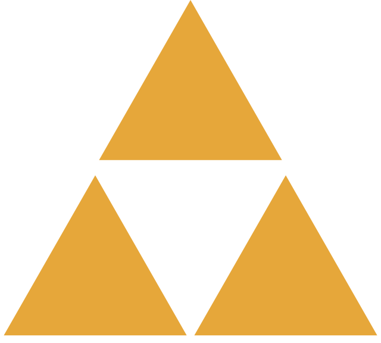
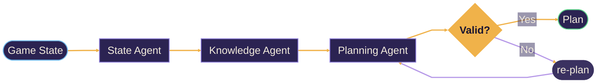

<!-- _class: cover -->
<!-- _paginate: false -->

<i></i><i></i><i></i><i></i><i></i><i></i>

[EVENT NAME / DATE]

Subtitle explaining the topic in one line

[First Last] · [Role]

---

<!-- _class: gold -->

01

<h2 class="h section-title">Section title</h2>

One sentence introducing the topic that follows

<i></i><i></i><i></i><i></i><i></i><i></i><i></i><i></i><i></i>

---

<!-- _class: light -->

SECTION 01
<h2 class="h">Slide title</h2>

First point, brief and concrete

Second point, one idea only

Third point with <strong>key word</strong> highlighted

<i></i><i></i><i></i><i></i><i></i><i></i><i></i><i></i><i></i>

---

<!-- _class: light -->

SECTION 01
<h2 class="h">Three ideas compared</h2>

1
<h3>First topic</h3>
Description in at most two lines.

2
<h3>Second topic</h3>
Description in at most two lines.

3
<h3>Third topic</h3>
Description in at most two lines.

<i></i><i></i><i></i><i></i><i></i><i></i><i></i><i></i><i></i>

---

<!-- _class: dark -->

9/9

The most important figure or quote, in one sentence

[Source or context]

<i></i><i></i><i></i><i></i><i></i><i></i><i></i><i></i><i></i>

---

<!-- _class: light -->

SECTION 01
<h2 class="h">Text and image</h2>

A short paragraph accompanying the image or screenshot on the right.

[Image or screenshot]

<i></i><i></i><i></i><i></i><i></i><i></i><i></i><i></i><i></i>

---

<!-- _class: light -->

SECTION 01
<h2 class="h">Notes and warnings</h2>

INFO

An informative note, useful but not essential.

SUCCESS

A result achieved or a good practice to follow.

WARNING

A warning about a risk or a limit to be aware of.

<i></i><i></i><i></i><i></i><i></i><i></i><i></i><i></i><i></i>

---

<!-- _class: light -->

SECTION 01
<h2 class="h">Comparison table</h2>

<table class="table">
<thead><tr><th>Scenario</th><th>RAG on</th><th>RAG off</th><th>Result</th></tr></thead>
<tbody>
<tr><td>anju-kafei</td><td>3 / 3</td><td>3 / 3</td><td class="tie">Tie</td></tr>
<tr><td>darmani-ghost</td><td>3 / 3</td><td>2 / 3</td><td class="improves">Improves</td></tr>
<tr><td>mikau-eggs</td><td>3 / 3</td><td>3 / 3</td><td class="tie">Tie</td></tr>
<tr><td>deed-chain</td><td>2 / 3</td><td>3 / 3</td><td class="worsens">Worsens</td></tr>
</tbody>
</table>

<i></i><i></i><i></i><i></i><i></i><i></i><i></i><i></i><i></i>

---

<!-- _class: light -->

SECTION 01
<h2 class="h">Code block</h2>

<i class="r"></i><i class="y"></i><i class="g"></i>graph.py

<pre>1# Builds the graph of the four agents
2graph = StateGraph(PlanningState)
3graph.add_node("state", state_agent.run)
4graph.add_node("knowledge", knowledge_agent.run)
5graph.add_node("planning", planning_agent.run)
6graph.add_node("critic", critic_agent.run)
7graph.add_edge("state", "knowledge")</pre>

<i></i><i></i><i></i><i></i><i></i><i></i><i></i><i></i><i></i>

---

<!-- _class: light -->

SECTION 01
<h2 class="h">Diagram</h2>

<i></i><i></i><i></i><i></i><i></i><i></i><i></i><i></i><i></i>

---

<!-- _class: dark -->
<!-- _paginate: false -->

<i></i><i></i><i></i><i></i><i></i><i></i>

Thank you

Questions and discussion

[name@domain.com]
[github.com/user]

